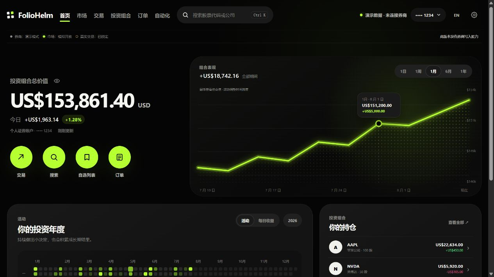
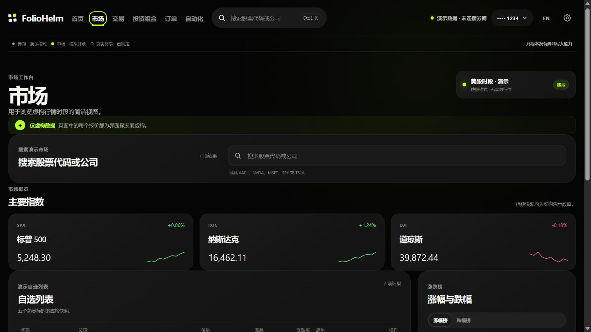
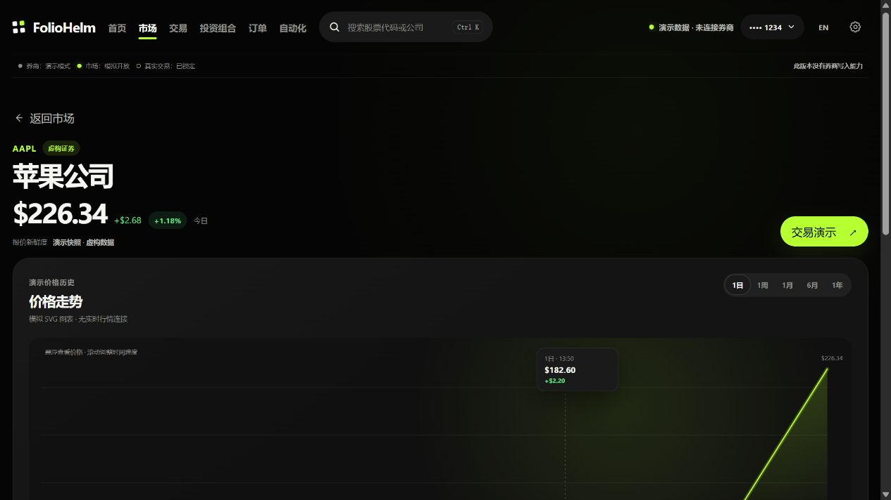
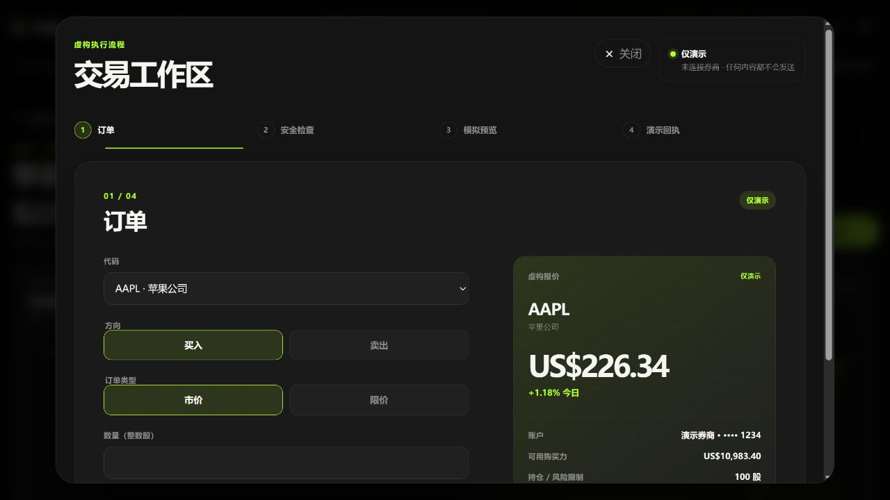
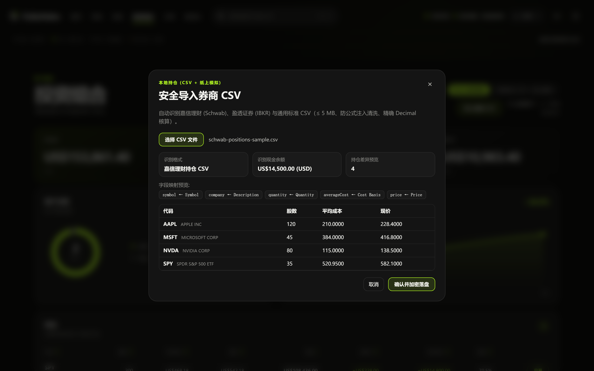
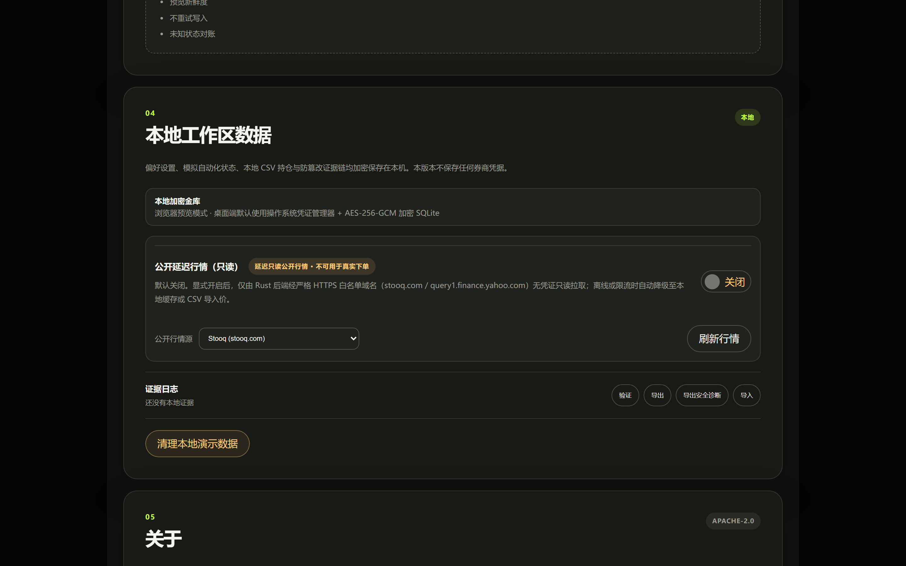

English | [简体中文](README.zh-CN.md)

# FolioHelm

FolioHelm is a local-first, security-first Windows desktop portfolio and paper-trading workbench built with **Tauri 2, Rust, React, and TypeScript**.

> FolioHelm runs in two isolated local modes — **Mock Demo** and **Local Portfolio (CSV + Paper)** — keeping all portfolio data on your machine. Live brokerage OAuth and order execution are planned once [API Gate](docs/api-gate.md) review is completed.

## What's Implemented (v0.2.0)

- **Encrypted Local Persistence & `.fhvault` Offline Backup (Fail-Closed)**:
  - Stores imported portfolios, multi-account profiles, daily NAV snapshots, cached benchmarks, cash-flow & dividend ledgers, watchlist targets, paper orders, evidence journal, cached quotes, automation policies, safety preferences, and rebalance targets in bundled SQLite (`WAL` + `secure_delete = ON`) encrypted at rest with **AES-256-GCM** (random 96-bit nonces + `schema_version|table|record_id` AAD) and `Zeroizing` plaintext buffers.
  - Stores the 256-bit database master key and **Ed25519** device signing seed in the OS credential manager (**Windows Credential Manager** / OS Keyring).
  - **`.fhvault` Offline Migration**: exports the full vault (including accounts, NAV history, cash flows, watchlist targets, and signing identity) using **Argon2id** + random 128-bit salt + **AES-256-GCM** + header AAD; restore verifies AEAD tags and the Ed25519 chain before atomically swapping databases, transitioning to Fail-Closed `ErrorLocked` if a rollback cannot reopen the original vault.
  - **Manual & Idle App Lock**: writes an Ed25519-signed `SessionLocked` event, wipes in-memory keys and frontend sensitive heap via a monotonic lock-epoch barrier, blocks unlock clicks while lock IPC is in flight, and verifies optional Argon2id passphrases with persisted exponential backoff.
- **Multi-Account Portfolios, Per-Currency Buckets & Real NAV / `i128` TWR**:
  - Manages multiple local brokerage accounts (`All Accounts` aggregate or single-account scope) with strict per-currency bucket isolation (`USD`, `HKD`, `CNY`, etc.) for allocation donuts, rebalance plans, and NAV tracking.
  - Computes real **Time-Weighted Return (TWR)** in pure `i128` / `BigInt` fixed-point micro-units with external cash-flow stripping and optional allowlisted benchmark overlay (`SPY`, `QQQ`, `2800.HK`, etc.) when at least 2 real snapshots exist.
- **Cash-Flow & Dividend Ledger + P&L Attribution**:
  - Records dividends, deposits, withdrawals, and fees encrypted in SQLite with Ed25519 evidence logging, isolated by account and currency bucket.
  - Ranks per-symbol P&L attribution combining unrealized price P&L and recorded dividends using exact `Decimal` math.
- **Local Watchlist & Price Target Alerts**:
  - Tracks custom buy/sell target prices per symbol in native currency inside the encrypted vault, comparing against local holding baselines or opted-in delayed public quotes.
  - Highlights triggered targets read-only and offers one-click prefill into the 4-step paper trade ticket for manual review.
- **Sanitized Portfolio Review Report Export (Markdown / CSV)**:
  - Exports currency-isolated holdings, P&L attribution, TWR summary, and cash-flow ledgers to Markdown or CSV via lock-protected native save dialogs (with browser Blob fallback), automatically redacting sensitive account-number patterns and neutralizing CSV formula prefixes.
- **Tamper-Evident Ed25519 Evidence Journal**:
  - Hash-chained, Ed25519-signed local audit journal tagging `mock` / `local-csv` workspace modes accurately on append and export, rejecting secret-like keys/tokens and enforcing a 20 MB import cap.
- **Safe Multi-Broker CSV Import & Target Rebalance Calculator**:
  - Supports **Charles Schwab**, **Interactive Brokers (IBKR)**, **Fidelity**, **Vanguard**, **Futu (富途)**, **Tiger (老虎)**, and **Standard CSV** (UTF-8/UTF-16/GBK, 5 MB / 10,000-row cap, formula sanitization, reverse-split inflation guard, exact `Decimal` cost basis, SHA-256 deduplication).
  - Read-only pure-`Decimal` rebalance planner (Full Rebalance & Cash-Only Buy modes) scoped per currency bucket with single-row paper ticket prefill.
- **Optional Read-Only Delayed Public Quotes (Off by Default)**:
  - Fetched exclusively by the Rust backend over HTTPS allowlisted hosts (`stooq.com`, `query1.finance.yahoo.com`, no custom ports or redirects), parsed in `i128` fixed-point with a 512 KiB streamed body cap, 4-way concurrency limit, 20s timeout, encrypted cache, and offline fallback.
- **Lock-Protected Native Dialogs & Strict CSP**:
  - Native `tauri-plugin-dialog` commands verify unlocked vault state before and after OS dialogs; WebView CSP blocks arbitrary external `connect-src` and unrestricted filesystem access.

### Roadmap

- Charles Schwab OAuth and live brokerage API integration (pending [API Gate](docs/api-gate.md))
- Real-time execution quotes and live order submission
- Optional remote notary checkpoint integration (local Ed25519 checkpoint/receipt primitives already exist in Rust)

## Interface Preview

Local workbench preview:









### Safe Brokerage CSV Import & Local Encrypted Vault Controls

**Safe Brokerage CSV Import & Field Mapping Preview** — Auto-detects Charles Schwab, Interactive Brokers (IBKR), and Standard CSVs with formula-injection sanitization, cash balance detection, field mapping preview, exact `Decimal` cost-basis calculation, and encrypted local persistence:



**Local Encrypted Vault & Optional Delayed Public Quotes** — Shows local AES-256-GCM + OS Credential Manager vault status, read-only delayed public quote toggle (off by default, HTTPS allowlist only), and Ed25519 evidence journal verification/export controls:



## Tech Stack

- **Desktop & Security Core**: Tauri 2 (`2.11.x`), Rust (`rusqlite` bundled, `aes-gcm`, `argon2`, `ed25519-dalek`, `subtle`, `zeroize`, `keyring`, `reqwest` `rustls-tls`, `tauri-plugin-dialog`)
- **Frontend**: React 19, TypeScript, Vite, Vitest, React Testing Library

## Security Boundaries

- **BYO Developer App**: Future broker integrations will require users to provide their own developer credentials under official terms.
- **No Secrets in Frontend or Logs**: Key material stays inside OS Credential Manager and Rust `Zeroizing` buffers; evidence payloads actively reject secret-like keys and tokens.
- **Live Trading Locked**: Real brokerage order submission is unavailable in this build.
- **No Automatic Write Retries**: Uncertain (`Unknown`) states require explicit reconciliation before continuing.
- **API Gate First**: Any future live API scope, rate limit, market-data license, and redistribution term must clear [docs/api-gate.md](docs/api-gate.md).

## Development & Verification

Prerequisites on Windows: Node.js 22+, Rust toolchain (`rust-toolchain.toml` / 1.92.0+), MSVC Build Tools, and WebView2.

```powershell
# Install frontend dependencies
npm install

# TypeScript check, Vitest unit/UI tests, and frontend production build
npx tsc -b
npm test
npm run build

# Rust formatting, locked unit tests (uses in-memory keystore; does not touch host Windows Credential Manager), and Clippy
$env:Path = "$env:USERPROFILE\.cargo\bin;$env:Path"
cargo fmt --manifest-path src-tauri/Cargo.toml --check
cargo test --manifest-path src-tauri/Cargo.toml --locked
cargo clippy --manifest-path src-tauri/Cargo.toml --locked --all-targets --all-features -- -D warnings

# Desktop dev mode (starts Vite + Tauri shell)
npm run desktop:dev

# Portable Windows desktop build (validates Tauri version parity, icons, CSP & frontend bundling)
npm run desktop:build:portable

# Full Windows installer build (NSIS)
npm run desktop:build
```

> Always build standalone Windows executables via `npm run desktop:build:portable` or `npm run desktop:build` rather than bare `cargo build`, so Tauri embeds the compiled frontend assets properly.

## Documentation

- [Engineering & Security Guide (`AGENTS.md`)](AGENTS.md)
- [ADR-0001: Dual Evidence Journal](docs/architecture-decisions/ADR-0001-dual-evidence-journal.md)
- [Security Policy](SECURITY.md) · [Security Model](docs/security-model.md) · [Evidence Threat Model](docs/security/evidence-threat-model-v1.md)
- [Evidence Journal Specification](docs/evidence-journal.md)
- [Mock Broker Contract](docs/mock-broker.md)
- [Schwab API Gate](docs/api-gate.md) · [Schwab API Capability Matrix](docs/schwab-api-capability-matrix-v1.md)
- [Test Plan](docs/test-plan.md) · [Windows Release Checklist](docs/release-checklist.md) · [Windows Toolchain Guide](docs/development/windows-toolchain.md)
- [Contributing Guide](CONTRIBUTING.md)
- [English User Guide](docs/user-guide-en.md) · [中文使用说明](docs/user-guide-zh.md)

## License & Disclaimer

Licensed under [Apache-2.0](LICENSE). Nothing in this software constitutes financial or investment advice. FolioHelm is an independent open-source project and is not affiliated with, sponsored by, or endorsed by Charles Schwab or Interactive Brokers.
