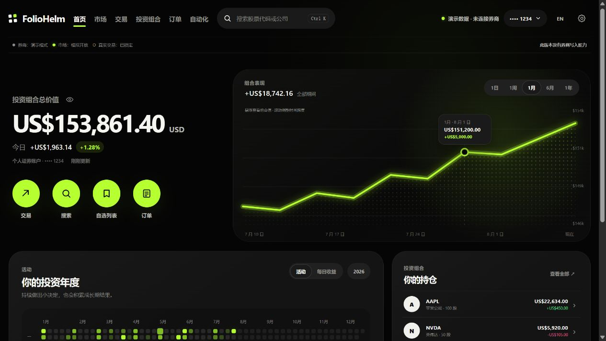
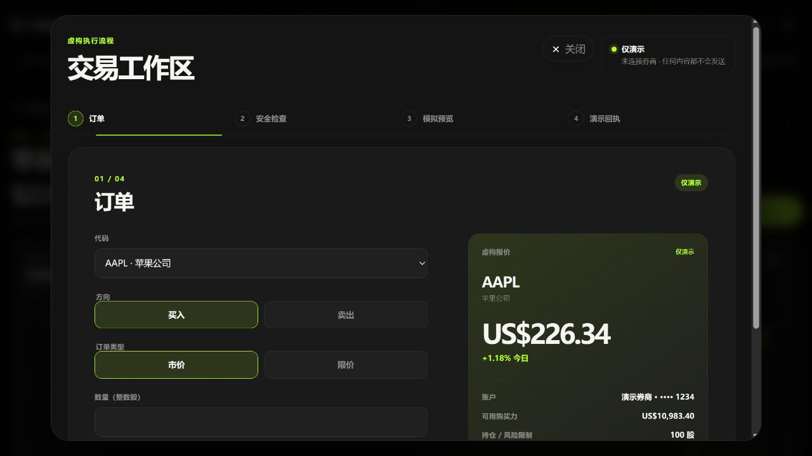

[English](README.md) | 简体中文

# FolioHelm

FolioHelm 是一款本地优先、安全优先的 Windows 桌面端投资组合与纸上模拟交易工作台，基于 **Tauri 2 + Rust + React + TypeScript** 构建。

> **诚实能力边界**：当前版本的 FolioHelm 提供两种严格隔离的本地工作模式——**Mock 演示模式** 与 **本地持仓模式 (CSV + 纸上模拟)**，不包含任何真实券商写入或实盘下单能力。Charles Schwab 实盘 OAuth 登录与真实下单能力仍待官方 [API Gate](docs/api-gate.md) 审批通过后才会评估接入。

## 已实现能力

- **本地加密持久化（Fail-Closed 安全优先）**：
  - 使用内置 SQLite（`rusqlite` `bundled`，启用 `WAL` 与 `PRAGMA secure_delete = ON`）结合 **AES-256-GCM** 认证加密落盘保存导入持仓、现金快照、纸上订单、证据链、行情缓存与安全设置；每条密文均使用随机 96-bit Nonce 并通过 AEAD AAD 严格绑定 `schema_version|table|record_id`，防止跨行/跨表密文替换。
  - 256-bit 数据库主密钥与 **Ed25519** 设备签名种子托管于操作系统凭证管理器（**Windows Credential Manager** / OS Keyring），内存密钥缓冲区使用 `zeroize` 在释放时自动擦除。
  - **严格 Fail-Closed**：当磁盘已存在加密库但操作系统密钥缺失，或解密/Canary 完整性校验失败时，应用明确锁死并原样保留密文，绝不静默降级为明文或覆盖清空已有数据。
- **Rust Ed25519 防篡改证据链**：
  - 将交易预览、用户确认、Unknown 订单对账、安全保护开关变更及 CSV 持仓导入自动写入带哈希链与 Ed25519 签名的本地证据日志，应用重启后完整恢复并自动验签；入库前主动拦截 API Key、Token、账号等敏感字段。
- **券商 CSV 持仓/交易安全导入与模式隔离**：
  - 自动识别 **Charles Schwab 持仓/交易 CSV**、**Interactive Brokers (IBKR) 活动报表/持仓 CSV** 以及 **通用标准 CSV**。
  - 强制执行 5 MB 文件体积上限与 10,000 行上限，清洗表格公式注入前缀（`=`, `+`, `-`, `@`），严格校验股票代码与非负数量，全链路使用**精确 `Decimal` / 整数定点数**核算成本均价、市值与盈亏（绝不用 IEEE-754 浮点），并通过确定性 SHA-256 指纹实现**幂等去重**（重复导入不会把持仓翻倍）。
  - 顶栏、系统状态栏与组合页清晰区分 **Mock 演示模式** 与 **本地持仓模式 (CSV + 纸上模拟)**，两套账本完全隔离、绝不混淆。
- **可选公开只读延迟行情源（默认关闭）**：
  - 严格本地优先，默认关闭所有联网请求。在「设置」页由用户显式开启后，仅经 Rust 后端（`reqwest` `rustls-tls`）向严格 HTTPS 白名单域名（`stooq.com`、`query1.finance.yahoo.com`）发起无 Cookie、无凭证头的只读拉取，禁止跨域名重定向，超时 ≤ 7 秒，结果加密缓存；离线或限流时自动平滑降级至本地缓存或 CSV 导入价。
  - 界面醒目标注 **「延迟只读公开行情 · 不可用于真实下单」**。
- **Tauri 原生文件对话框与严格 CSP**：
  - 桌面端导入 CSV 与导出证据包/安全诊断时优先调用受控的 Rust `tauri-plugin-dialog` 原生文件对话框（并在浏览器预览/测试环境自动降级为 `<input type="file">` 与延迟释放 Blob 下载），前端不授予任意文件系统权限。
  - 维持严格的 WebView CSP，绝不向前端放开任意外网 `connect-src`。
- **完整交互工作台**：
  - 全局搜索（`Ctrl+K`）、市场与个股浏览、组合资产分布与收益曲线、年度投资活动/收益热力图、Working / Filled / Canceled / Rejected / Unknown 订单时间线与对账闭环、四步纸上模拟交易流（订单 → 安全检查 → 模拟预览 → 演示回执）。

### 明确未实现（受 API Gate 约束）

- Charles Schwab 实盘 OAuth 登录与真实券商 API 直连
- 券商级实时可执行报价与真实资金下单
- 远端公证（Notary）服务部署（Rust 层已预留隐私最小化 Commitment / Receipt 原语，当前版本不发起任何远端公证请求）

## 界面预览

以下截图来自本地工作台演示（16:9 比例；展示的行情、持仓与订单数据均为虚构演示内容）：






## 技术栈

- **桌面壳与安全内核**：Tauri 2（`2.11.x`）、Rust（`rusqlite` `bundled`、`aes-gcm`、`ed25519-dalek`、`zeroize`、`keyring`、`reqwest` `rustls-tls`、`tauri-plugin-dialog`）
- **前端界面**：React 19、TypeScript、Vite、Vitest、React Testing Library

## 安全边界

- **BYO Developer App**：未来若接入实盘券商接口，使用者需按官方条款自行提供并管理开发者应用配置。
- **秘密不入前端与日志**：密钥托管于 OS Credential Manager 并在 Rust 侧零化擦除；证据日志严格拒收凭证与账号类字段。
- **真实交易默认锁定**：当前版本无任何券商写入或下单能力。
- **不做自动写入重试**：遇到 `Unknown` 状态必须先显式对账，再继续后续操作。
- **API Gate 优先**：任何实盘 API 权限、限流、行情许可与开源分发条款都必须先通过 [docs/api-gate.md](docs/api-gate.md) 审查。

## 开发与验证

Windows 环境前置依赖：Node.js 22+、Rust 工具链（`rust-toolchain.toml` / 1.92.0+）、MSVC Build Tools 与 WebView2。

```powershell
# 安装前端依赖
npm install

# TypeScript 类型检查、Vitest 单元/界面测试与前端构建
npx tsc -b
npm test
npm run build

# Rust 格式化检查、锁定依赖单元测试（使用内存密钥库，不污染宿主机 Windows 凭证管理器）与严格 Clippy
$env:Path = "$env:USERPROFILE\.cargo\bin;$env:Path"
cargo fmt --manifest-path src-tauri/Cargo.toml --check
cargo test --manifest-path src-tauri/Cargo.toml --locked
cargo clippy --manifest-path src-tauri/Cargo.toml --locked --all-targets --all-features -- -D warnings

# Tauri 桌面开发模式（自动启动 Vite）
npm run desktop:dev

# 便携版 Windows 桌面构建（校验 Tauri 版本对齐、正式图标、CSP 与前端资源打包）
npm run desktop:build:portable

# 完整 Windows 安装包构建（NSIS）
npm run desktop:build
```

> 生成可独立运行的 Windows 可执行文件请务必使用 `npm run desktop:build:portable` 或 `npm run desktop:build`，不要用裸 `cargo build` 替代，以确保前端静态资源由 Tauri CLI 完整嵌入。

## 设计与安全文档

- [工程与安全规范（`AGENTS.md`）](AGENTS.md)
- [ADR-0001：双证据日志架构决策](docs/architecture-decisions/ADR-0001-dual-evidence-journal.md)
- [安全策略](SECURITY.md) · [安全模型](docs/security-model.md) · [证据链威胁模型](docs/security/evidence-threat-model-v1.md)
- [证据日志说明](docs/evidence-journal.md)
- [Mock Broker 契约](docs/mock-broker.md)
- [Schwab API Gate](docs/api-gate.md) · [Schwab API 能力矩阵](docs/schwab-api-capability-matrix-v1.md)
- [测试计划](docs/test-plan.md) · [Windows 发布清单](docs/release-checklist.md) · [Windows 工具链指南](docs/development/windows-toolchain.md)
- [贡献指南](CONTRIBUTING.md)
- [English User Guide](docs/user-guide-en.md) · [中文使用说明](docs/user-guide-zh.md)

## 许可与免责声明

本项目采用 [Apache-2.0](LICENSE) 开源许可。软件及文档内容不构成任何投资或财务建议。FolioHelm 是独立开源项目，与 Charles Schwab 或 Interactive Brokers 不存在任何隶属、赞助或认可关系。
