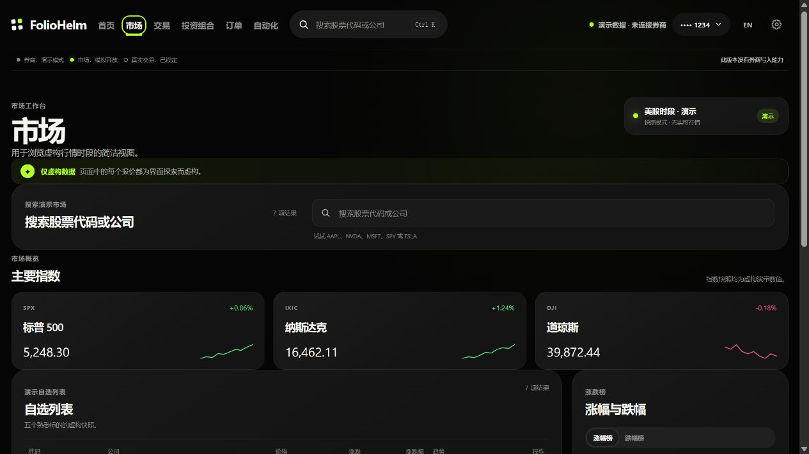
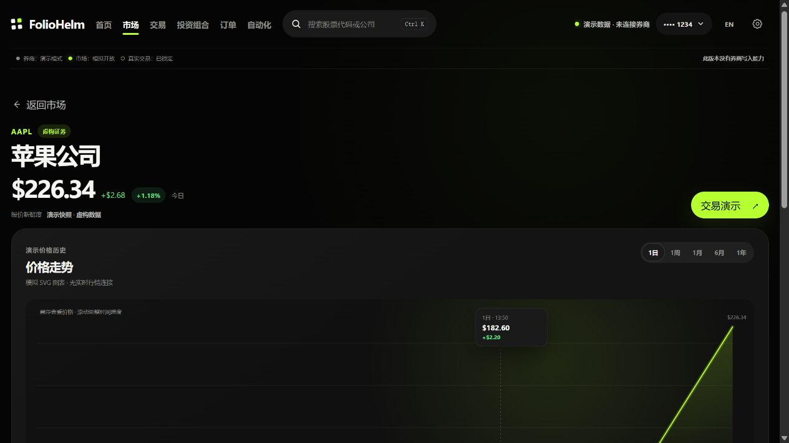
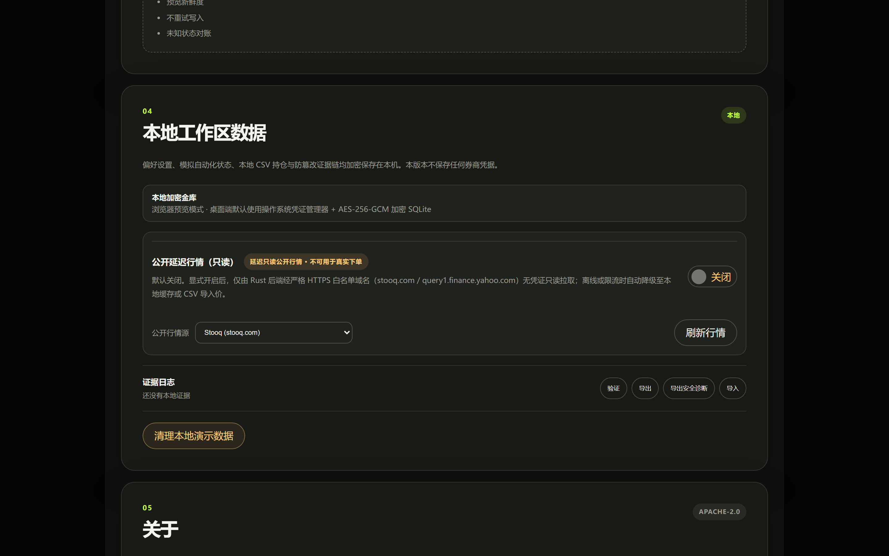

[English](README.md) | 简体中文

# FolioHelm

FolioHelm 是一款本地优先、安全优先的 Windows 桌面端投资组合与纸上模拟交易工作台，基于 **Tauri 2 + Rust + React + TypeScript** 构建。

> FolioHelm 提供 **Mock 演示模式** 与 **本地持仓模式（CSV + 纸上模拟）** 两种隔离的本地工作模式，持仓与交易演练数据均保存在本机。实盘券商 OAuth 登录与下单功能将在 [API Gate](docs/api-gate.md) 评审后按计划接入。

## 已实现能力

- **本地加密持久化、`.fhvault` 离线备份与真实锁屏（Fail-Closed 安全优先）**：
  - 使用内置 SQLite（`rusqlite` `bundled`，启用 `WAL` 与 `PRAGMA secure_delete = ON`）结合 **AES-256-GCM** 认证加密落盘保存导入持仓、现金快照、纸上订单、证据链、行情缓存、自动化策略、安全设置与再平衡目标权重；每条密文均使用随机 96-bit Nonce 并通过 AEAD AAD 严格绑定 `schema_version|table|record_id`，支持旧浏览器配置无损迁移，重启桌面端后自动恢复用户的 `local-csv` 工作区与加密行情缓存。
  - 256-bit 数据库主密钥与 **Ed25519** 设备签名种子托管于操作系统凭证管理器（**Windows Credential Manager** / OS Keyring），内存密钥缓冲区使用 `zeroize` 在释放时自动擦除。
  - **`.fhvault` 口令加密离线迁移备份**：采用 **Argon2id** + 随机 128-bit 盐 + **AES-256-GCM** + 格式/版本 AAD 导出全库加密快照；恢复时先完成认证解密与整条 Ed25519 证据链验签再原子替换现有金库（Fail-Closed：任何校验失败绝不破坏现有数据库）。证据与备份导入统一强制 20 MB 硬上限。
  - **真实手动与空闲自动锁屏（App Lock）**：锁定前写入 Ed25519 签名 `SessionLocked` 证据，随即释放并 `Zeroizing` 擦除内存会话密钥，前端卸载持仓 DOM 弹出锁屏遮罩；解锁支持可选 Argon2id 常量时间口令校验与指数退避防爆破（口令绝不落盘或入日志）。
  - **严格 Fail-Closed**：当磁盘已存在加密库但操作系统密钥缺失，或解密/Canary 完整性校验失败时，应用明确锁死并原样保留密文，绝不静默降级为明文或覆盖清空已有数据。
- **Rust Ed25519 防篡改证据链**：
  - 将交易预览、用户确认、Unknown 订单对账、安全保护开关变更、锁屏事件（`SessionLocked`）及 CSV 持仓导入（准确标注 `mock` / `local-csv` 模式）自动写入带哈希链与 Ed25519 签名的本地证据日志，应用重启后完整恢复并自动验签；入库前主动拦截 API Key、Token、账号等敏感字段。
- **多券商 CSV 安全导入、多币种 Fail-Safe 隔离与全站本地持仓联动**：
  - 自动识别 **嘉信理财 (Schwab)**、**盈透证券 (IBKR)**、**Fidelity**、**Vanguard**、**富途 (Futu)**、**老虎 (Tiger)** 与 **通用标准 CSV**。
  - 强制执行 5 MB 文件体积上限与 10,000 行上限，清洗表格公式注入前缀（`=`, `+`, `-`, `@`），严格校验股票代码与非负数量，全链路使用**精确 `Decimal` / 整数定点数**核算成本均价、市值与盈亏（绝不用 IEEE-754 浮点），并通过确定性 SHA-256 指纹实现**幂等去重**。
  - **多币种独立隔离**：检测到多结算币种（如 USD + HKD）时按币种桶独立核算小计、配置权重与再平衡计划，不跨币种混算。
  - **全站任意标的联动**：导入的任意非演示标的（如 `VOO`、`QQQ`、`BRK.B`、`00700.HK`）在首页、全局搜索（`Ctrl+K`）、市场、个股详情、组合、纸上交易与订单页均可基于真实导入持仓、本地行情缓存与净值快照联动展示。
- **目标仓位配置与只读再平衡计算器（纯 Decimal）**：
  - 组合页内置多标的持仓分配环形图与纯 Decimal 再平衡规划器，严格校验持仓 + 现金目标权重合计等于 **100%**，支持 **「存量调仓」** 与 **「仅新增现金买入」** 双模式，配置经加密设置持久化。
  - 单条调仓建议支持一键预填至四步纸上模拟交易单进行人工复核演练（仅支持人工复核下单，不支持自动批量执行）。
- **加固的可选公开只读延迟行情源（默认关闭）**：
  - 严格本地优先，默认关闭所有联网请求。在「设置」页由用户显式开启后，仅经 Rust 后端（`reqwest` `rustls-tls`）向严格 HTTPS 白名单域名（`stooq.com`、`query1.finance.yahoo.com`，强制 `url.port().is_none()` 与禁止重定向）发起只读拉取；全链路**零 `f64`**（`i128` 定点解析），强制 512 KiB 响应体流式上限、4 并发受限批量拉取与 20 秒总超时保护，结果加密缓存；离线或限流时自动平滑降级至本地缓存或 CSV 导入价。
- **Tauri 原生文件对话框与严格 CSP**：
  - 桌面端导入 CSV 与导出证据包/安全诊断时优先调用受控的 Rust `tauri-plugin-dialog` 原生文件对话框（并在浏览器预览/测试环境自动降级为 `<input type="file">` 与延迟释放 Blob 下载），前端不授予任意文件系统权限。
  - 维持严格的 WebView CSP，不向前端放开任意外网 `connect-src`。
- **完整交互工作台**：
  - 全局搜索（`Ctrl+K`）、市场与个股浏览、组合资产分布与收益曲线、年度投资活动/收益热力图、Working / Filled / Canceled / Rejected / Unknown 订单时间线与对账闭环、四步纸上模拟交易流（订单 → 安全检查 → 模拟预览 → 演示回执）。

### 后续规划

- Charles Schwab 实盘 OAuth 登录与券商 API 接入（待 [API Gate](docs/api-gate.md) 评审）
- 实时可执行行情与实盘下单
- 可选远端公证（Notary）服务对接（Rust 侧已内置本地 Ed25519 Commitment / Receipt 原语）

## 界面预览

以下为本地工作台界面预览：







### 券商 CSV 安全导入与本地加密金库设置

**券商 CSV 安全导入与字段映射预览** —— 自动识别嘉信理财（Schwab）、盈透证券（IBKR）与通用标准 CSV，展示防公式注入清洗、现金余额识别、字段映射预览、精确 `Decimal` 成本均价核算及加密落盘确认：


**本地加密金库与公开延迟行情控制** —— 展示操作系统凭证管理器 + AES-256-GCM 加密 SQLite 本地金库状态、默认关闭的只读公开延迟行情 HTTPS 白名单开关，以及 Ed25519 证据日志验签与导出入口：



## 技术栈

- **桌面壳与安全内核**：Tauri 2（`2.11.x`）、Rust（`rusqlite` `bundled`、`aes-gcm`、`argon2`、`ed25519-dalek`、`subtle`、`zeroize`、`keyring`、`reqwest` `rustls-tls`、`tauri-plugin-dialog`）
- **前端界面**：React 19、TypeScript、Vite、Vitest、React Testing Library

## 安全边界

- **BYO Developer App**：未来若接入实盘券商接口，使用者需按官方条款自行提供并管理开发者应用配置。
- **秘密不入前端与日志**：密钥托管于 OS Credential Manager 并在 Rust 侧零化擦除；证据日志严格拒收凭证与账号类字段。
- **真实交易默认锁定**：当前版本无任何券商写入或下单能力。
- **不做自动写入重试**：遇到 `Unknown` 状态必须先显式对账，再继续后续操作。
- **API Gate 优先**：任何实盘 API 权限、限流、行情许可与开源分发条款都必须先通过 [docs/api-gate.md](docs/api-gate.md) 审查。

## 开发与验证

Windows 环境前置依赖：Node.js 22+、Rust 工具链（`rust-toolchain.toml` / 1.92.0+）、MSVC Build Tools 与 WebView2。

```powershell
# 安装前端依赖
npm install

# TypeScript 类型检查、Vitest 单元/界面测试与前端构建
npx tsc -b
npm test
npm run build

# Rust 格式化检查、锁定依赖单元测试（使用内存密钥库，不污染宿主机 Windows 凭证管理器）与严格 Clippy
$env:Path = "$env:USERPROFILE\.cargo\bin;$env:Path"
cargo fmt --manifest-path src-tauri/Cargo.toml --check
cargo test --manifest-path src-tauri/Cargo.toml --locked
cargo clippy --manifest-path src-tauri/Cargo.toml --locked --all-targets --all-features -- -D warnings

# Tauri 桌面开发模式（自动启动 Vite）
npm run desktop:dev

# 便携版 Windows 桌面构建（校验 Tauri 版本对齐、正式图标、CSP 与前端资源打包）
npm run desktop:build:portable

# 完整 Windows 安装包构建（NSIS）
npm run desktop:build
```

> 生成可独立运行的 Windows 可执行文件请务必使用 `npm run desktop:build:portable` 或 `npm run desktop:build`，不要用裸 `cargo build` 替代，以确保前端静态资源由 Tauri CLI 完整嵌入。

## 设计与安全文档

- [工程与安全规范（`AGENTS.md`）](AGENTS.md)
- [ADR-0001：双证据日志架构决策](docs/architecture-decisions/ADR-0001-dual-evidence-journal.md)
- [安全策略](SECURITY.md) · [安全模型](docs/security-model.md) · [证据链威胁模型](docs/security/evidence-threat-model-v1.md)
- [证据日志说明](docs/evidence-journal.md)
- [Mock Broker 契约](docs/mock-broker.md)
- [Schwab API Gate](docs/api-gate.md) · [Schwab API 能力矩阵](docs/schwab-api-capability-matrix-v1.md)
- [测试计划](docs/test-plan.md) · [Windows 发布清单](docs/release-checklist.md) · [Windows 工具链指南](docs/development/windows-toolchain.md)
- [贡献指南](CONTRIBUTING.md)
- [English User Guide](docs/user-guide-en.md) · [中文使用说明](docs/user-guide-zh.md)

## 许可与免责声明

本项目采用 [Apache-2.0](LICENSE) 开源许可。软件及文档内容不构成任何投资或财务建议。FolioHelm 是独立开源项目，与 Charles Schwab 或 Interactive Brokers 不存在任何隶属、赞助或认可关系。
