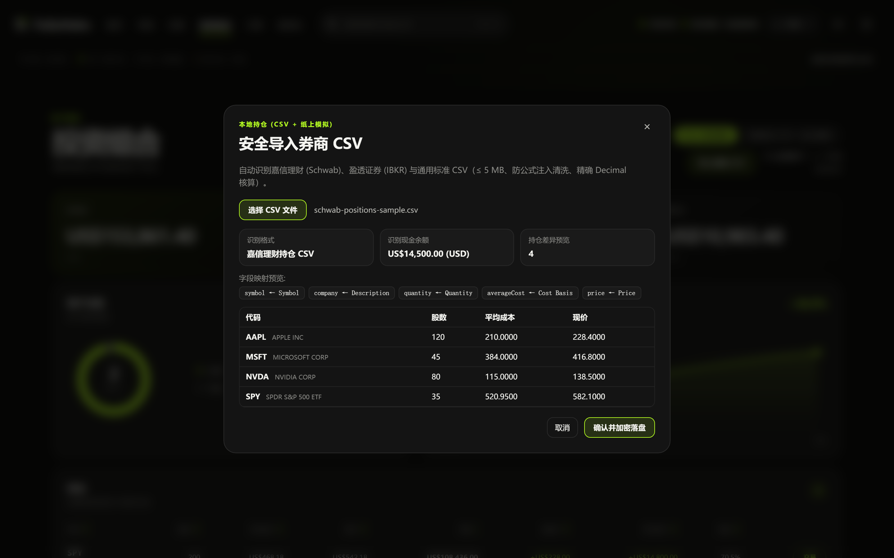

[English](README.md) | 简体中文

# FolioHelm

FolioHelm 是一款本地优先、安全优先的 Windows 桌面端投资组合与纸上模拟交易工作台，基于 **Tauri 2 + Rust + React + TypeScript** 构建。

> FolioHelm 提供 **Mock 演示模式** 与 **本地持仓模式（CSV + 纸上模拟）** 两种隔离的本地工作模式，持仓与交易演练数据均保存在本机。实盘券商 OAuth 登录与下单功能将在 [API Gate](docs/api-gate.md) 评审后按计划接入。

## 已实现能力 (v0.2.0)

- **本地加密持久化、`.fhvault` 离线备份与真实锁屏（Fail-Closed）**：
  - 使用内置 SQLite（`WAL` + `secure_delete = ON`）结合 **AES-256-GCM**（随机 96-bit Nonce + `schema_version|table|record_id` AAD）与 `Zeroizing` 内存擦除，加密存储多账户配置、CSV 持仓、每日 NAV 快照、基准缓存、分红与现金流台账、自选目标价预警、纸上订单、Ed25519 证据链、行情缓存、自动化策略、再平衡权重与安全设置。
  - 256-bit 数据库主密钥与 **Ed25519** 设备签名种子托管于操作系统凭证管理器（**Windows Credential Manager** / OS Keyring）。
  - **`.fhvault` 离线迁移备份**：采用 **Argon2id** + 随机 128-bit 盐 + **AES-256-GCM** + 头部参数 AAD 导出完整金库；恢复前完成 AEAD 认证与整条 Ed25519 链验签再原子替换，回滚异常时立即切换为 Fail-Closed `ErrorLocked`。
  - **手动与空闲自动锁屏（App Lock）**：锁定前写入 Ed25519 签名 `SessionLocked` 证据，立即擦除后端会话密钥与前端敏感内存并推进锁屏代际（Lock Epoch），锁屏 IPC 进行期间阻断解锁竞态，解锁支持可选 Argon2id 口令校验与跨重启持久化指数退避。
- **多账户分币种桶管理与真实 NAV / `i128` TWR 绩效**：
  - 支持管理多个本地券商账户（「全部账户」聚合或单账户视图），按结算币种桶（USD / HKD / CNY 等）独立隔离资产占比、再平衡计算与净值快照。
  - 采用纯 `i128` / `BigInt` 微单位定点数计算真实**时间加权收益率（TWR）**，支持剔除外部出入金并叠加白名单基准对比（如 `SPY`、`QQQ`、`2800.HK`），不足 2 个真实快照点时不生成模拟曲线。
- **分红与现金流台账 + 按标的盈亏归因**：
  - 在加密金库中记录股息分红、出入金与费用/税费，写入 Ed25519 证据链，并按账户与币种桶独立汇总。
  - 基于纯 `Decimal` 核算各标的未实现盈亏与已登记分红，生成按标的盈亏贡献排行。
- **本地自选观察表与目标价预警**：
  - 支持在加密金库中维护任意标的的买入/卖出目标价，按同币种本地持仓基准价或已开启的延迟公开行情实时比对并高亮触达徽章；支持一键预填四步纸上模拟交易单进行人工复核。
- **脱敏组合复盘报告导出（Markdown / CSV）**：
  - 基于当前账户与币种桶生成结构化 Markdown 或 CSV 复盘报告（涵盖持仓、盈亏归因、TWR 与现金流台账），自动脱敏敏感账户编号并中和 CSV 公式注入前缀，通过受锁屏保护的原生保存对话框导出。
- **Rust Ed25519 防篡改证据链**：
  - 自动记录交易演练、对账、配置变更、锁屏与导入事件，导出时准确携带真实工作区模式（`mock` / `local-csv`），拒收敏感字段并强制 20 MB 导入上限。
- **多券商 CSV 安全导入与目标仓位再平衡**：
  - 支持 **嘉信理财 (Schwab)**、**盈透 (IBKR)**、**Fidelity**、**Vanguard**、**富途 (Futu)**、**老虎 (Tiger)** 与 **通用标准 CSV**（兼容 UTF-8/UTF-16/GBK、5 MB / 10,000 行上限、公式注入清洗、合股防虚增保护、纯 `Decimal` 核算与 SHA-256 幂等去重）。
  - 组合页内置按币种桶隔离的纯 `Decimal` 只读再平衡计算器（存量调仓 / 仅新增现金买入）与单行预填纸上模拟单入口。
- **可选公开只读延迟行情源（默认关闭）**：
  - 显式开启后由 Rust 后端向严格 HTTPS 白名单（`stooq.com`、`query1.finance.yahoo.com`，禁止自定义端口与重定向）拉取，全链路 `i128` 定点解析，强制 512 KiB 流式上限、4 并发受限与 20 秒超时，并自动降级至加密缓存。
- **受锁屏保护的原生文件对话框与严格 CSP**：
  - 桌面端原生打开/保存对话框均在弹窗前后校验金库解锁态；维持严格 WebView CSP 与最小权限边界。

### 后续规划

- Charles Schwab 实盘 OAuth 登录与券商 API 接入（待 [API Gate](docs/api-gate.md) 评审）
- 实时可执行行情与实盘下单
- 可选远端公证（Notary）服务对接（Rust 侧已内置本地 Ed25519 Commitment / Receipt 原语）

## 界面预览

以下为本地工作台界面预览：


### 券商 CSV 安全导入与本地加密金库设置

**券商 CSV 安全导入与字段映射预览** —— 自动识别嘉信理财（Schwab）、盈透证券（IBKR）与通用标准 CSV，展示防公式注入清洗、现金余额识别、字段映射预览、精确 `Decimal` 成本均价核算及加密落盘确认：



**本地加密金库与公开延迟行情控制** —— 展示操作系统凭证管理器 + AES-256-GCM 加密 SQLite 本地金库状态、默认关闭的只读公开延迟行情 HTTPS 白名单开关，以及 Ed25519 证据日志验签与导出入口：


## 技术栈

- **桌面壳与安全内核**：Tauri 2（`2.11.x`）、Rust（`rusqlite` `bundled`、`aes-gcm`、`argon2`、`ed25519-dalek`、`subtle`、`zeroize`、`keyring`、`reqwest` `rustls-tls`、`tauri-plugin-dialog`）
- **前端界面**：React 19、TypeScript、Vite、Vitest、React Testing Library

## 安全边界

- **BYO Developer App**：未来若接入实盘券商接口，使用者需按官方条款自行提供并管理开发者应用配置。
- **秘密不入前端与日志**：密钥托管于 OS Credential Manager 并在 Rust 侧零化擦除；证据日志严格拒收凭证与账号类字段。
- **真实交易默认锁定**：当前版本无任何券商写入或下单能力。
- **不做自动写入重试**：遇到 `Unknown` 状态必须先显式对账，再继续后续操作。
- **API Gate 优先**：任何实盘 API 权限、限流、行情许可与开源分发条款都必须先通过 [docs/api-gate.md](docs/api-gate.md) 审查。

## 开发与验证

Windows 环境前置依赖：Node.js 22+、Rust 工具链（`rust-toolchain.toml` / 1.92.0+）、MSVC Build Tools 与 WebView2。

```powershell
# 安装前端依赖
npm install

# TypeScript 类型检查、Vitest 单元/界面测试与前端构建
npx tsc -b
npm test
npm run build

# Rust 格式化检查、锁定依赖单元测试（使用内存密钥库，不污染宿主机 Windows 凭证管理器）与严格 Clippy
$env:Path = "$env:USERPROFILE\.cargo\bin;$env:Path"
cargo fmt --manifest-path src-tauri/Cargo.toml --check
cargo test --manifest-path src-tauri/Cargo.toml --locked
cargo clippy --manifest-path src-tauri/Cargo.toml --locked --all-targets --all-features -- -D warnings

# Tauri 桌面开发模式（自动启动 Vite）
npm run desktop:dev

# 便携版 Windows 桌面构建（校验 Tauri 版本对齐、正式图标、CSP 与前端资源打包）
npm run desktop:build:portable

# 完整 Windows 安装包构建（NSIS）
npm run desktop:build
```

> 生成可独立运行的 Windows 可执行文件请务必使用 `npm run desktop:build:portable` 或 `npm run desktop:build`，不要用裸 `cargo build` 替代，以确保前端静态资源由 Tauri CLI 完整嵌入。

## 设计与安全文档

- [工程与安全规范（`AGENTS.md`）](AGENTS.md)
- [ADR-0001：双证据日志架构决策](docs/architecture-decisions/ADR-0001-dual-evidence-journal.md)
- [安全策略](SECURITY.md) · [安全模型](docs/security-model.md) · [证据链威胁模型](docs/security/evidence-threat-model-v1.md)
- [证据日志说明](docs/evidence-journal.md)
- [Mock Broker 契约](docs/mock-broker.md)
- [Schwab API Gate](docs/api-gate.md) · [Schwab API 能力矩阵](docs/schwab-api-capability-matrix-v1.md)
- [测试计划](docs/test-plan.md) · [Windows 发布清单](docs/release-checklist.md) · [Windows 工具链指南](docs/development/windows-toolchain.md)
- [贡献指南](CONTRIBUTING.md)
- [English User Guide](docs/user-guide-en.md) · [中文使用说明](docs/user-guide-zh.md)

## 许可与免责声明

本项目采用 [Apache-2.0](LICENSE) 开源许可。软件及文档内容不构成任何投资或财务建议。FolioHelm 是独立开源项目，与 Charles Schwab 或 Interactive Brokers 不存在任何隶属、赞助或认可关系。
